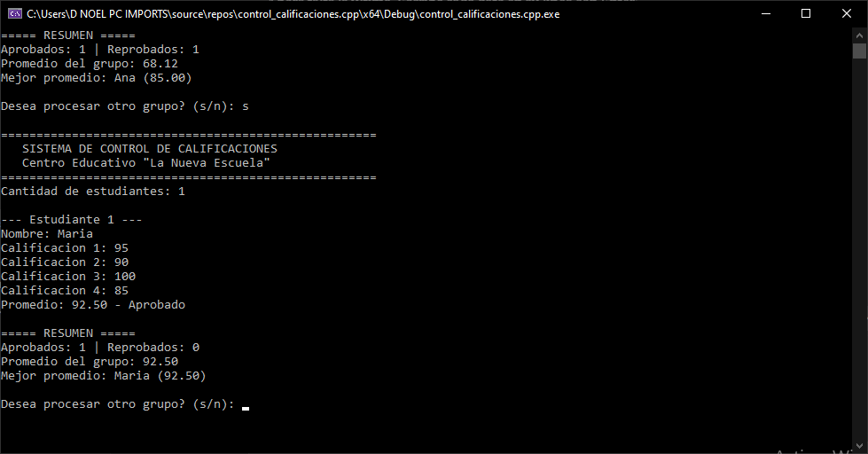
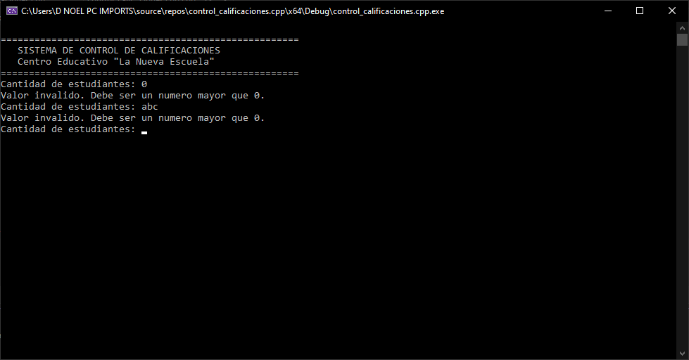
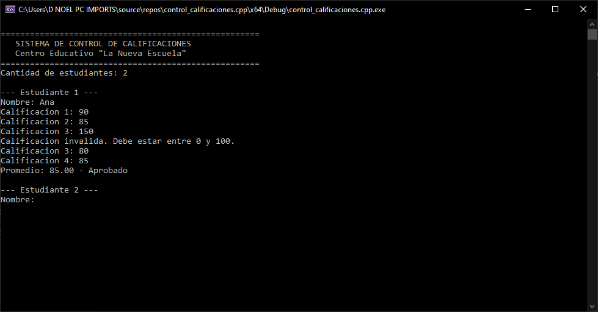
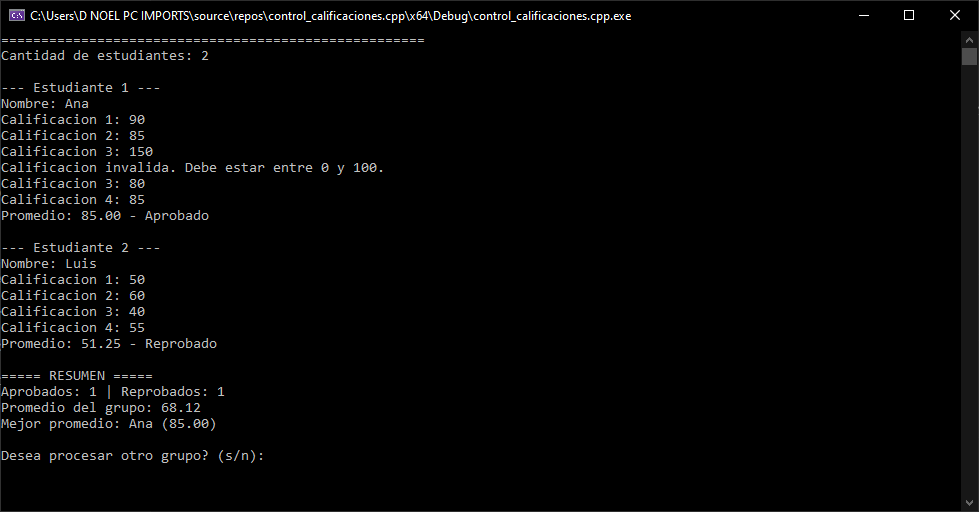
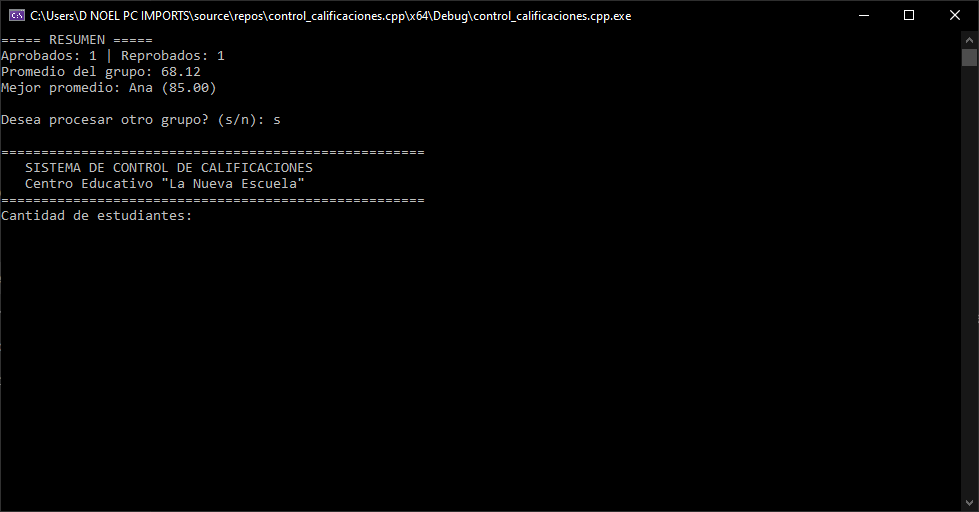

# Sistema de control de calificaciones de un centro educativo

**Estudiante:** Camilo Salas Jimenez
**Matrícula:** 2025-2431
**Asignatura:** Lógica de Programación
**Profesor:** Gamalier Reyes del Carmen
**Tema:** Uso de bucles (estructuras de control repetitivas) en C++

## Descripción del programa

Programa de consola en C++ para el centro educativo "La Nueva Escuela". Permite registrar las calificaciones de un grupo de estudiantes, calcular el promedio de cada uno, indicar si está **Aprobado** (70 o más) o **Reprobado**, y mostrar un resumen general del grupo. Al terminar, pregunta si se desea procesar otro grupo.

## Datos de entrada

- Cantidad de estudiantes del grupo (número entero mayor que 0).
- Por cada estudiante: nombre y 4 calificaciones (cada una entre 0 y 100).
- Respuesta final `s` / `n` para procesar otro grupo.

## Proceso

1. Se pide la cantidad de estudiantes y se valida que sea mayor que 0.
2. Por cada estudiante se pide el nombre y las 4 calificaciones, validando que cada una esté entre 0 y 100.
3. Se acumulan las notas en `sumaNotas` y se calcula el promedio (`sumaNotas / 4`).
4. Se decide si está Aprobado o Reprobado y se actualizan los contadores `cantidadAprobados` y `cantidadReprobados`.
5. Se acumula el promedio en `sumaPromedios` y se guarda el estudiante con el promedio más alto.
6. Al terminar el grupo se calcula el promedio general (`sumaPromedios / cantidadEstudiantes`).
7. Se pregunta si se desea procesar otro grupo; si la respuesta es `s`, se repite desde el paso 1.

## Salida

- Promedio de cada estudiante con dos decimales y su condición (Aprobado / Reprobado).
- Resumen del grupo: cantidad de aprobados y reprobados, promedio del grupo y nombre y promedio del mejor estudiante.

Ejemplo:

```
===== RESUMEN =====
Aprobados: 1 | Reprobados: 1
Promedio del grupo: 68.12
Mejor promedio: Ana (85.00)
```

## Capturas de pantalla de la ejecución

**1. Ejecución normal con un grupo**


**2. Validación de la cantidad de estudiantes (0 y valor no numérico)**


**3. Validación de calificaciones fuera de rango**


**4. Resumen con aprobados y reprobados**


**5. Procesar otro grupo (respuesta `s`) y salir (respuesta `n`)**


## Dónde y por qué se usó cada tipo de bucle

| Bucle | Dónde se usa | Por qué |
|---|---|---|
| `do-while` | Bucle principal que envuelve todo el programa | El grupo debe procesarse al menos una vez antes de preguntar si se repite. |
| `for` | Recorre a los estudiantes (1 hasta `cantidadEstudiantes`) | Se sabe de antemano cuántas veces se repite. |
| `for` | Recorre las 4 calificaciones de cada estudiante | Siempre son exactamente 4, y se van sumando en `sumaNotas`. |
| `while` | Validación de la cantidad de estudiantes | Se repite solo mientras el dato sea inválido; si es válido de entrada, no se ejecuta. |
| `while` | Validación de cada calificación (0 a 100) | Repite la solicitud de esa calificación hasta que esté en rango. |
| `while` | Validación del nombre y de la respuesta `s/n` | Impide continuar con un nombre vacío o una respuesta no válida. |

## Cómo compilar y ejecutar

Abrir `control_calificaciones.cpp` en Visual Studio y ejecutar con `Ctrl + F5`. También puede compilarse con `g++ control_calificaciones.cpp -o programa`.
